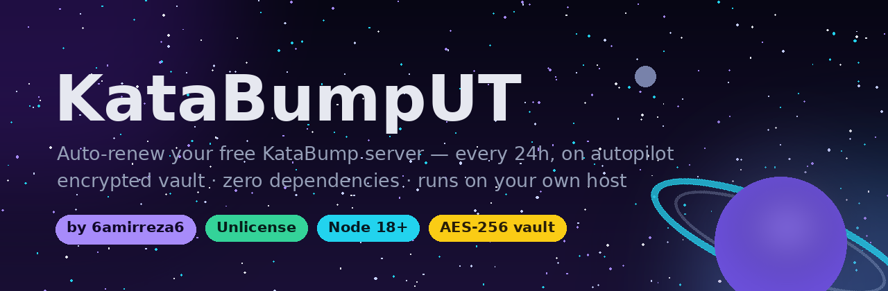
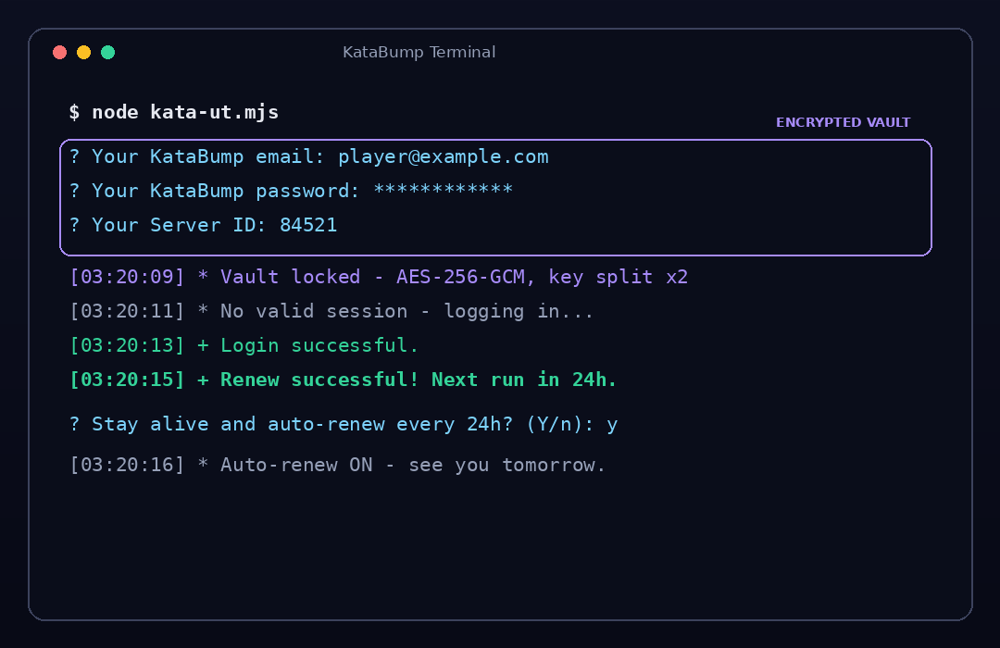

<div align="center">




**تمدید خودکار سرور رایگان KataBump — هر ۲۴ ساعت، با گاوصخچه‌ی رمزنگاری‌شده**
**Auto-renew your free KataBump server every 24h — with an encrypted vault**

[🌐 وب‌سایت / Website](https://6amirreza6.github.io/KatabumpUT/) · [GitHub](https://github.com/6amirreza6/KatabumpUT)

</div>

---

## 🇮🇷 فارسی

### این چیست؟

سرورهای **رایگان** [KataBump](https://katabump.com) هر **۴ روز** باید از پنل تمدید (Renew) بشن، وگرنه خاموش می‌شن. این ابزار یه اسکریپت تعاملیه که **داخل ترمینال همون هاست کاتابامپ خودت** اجرا می‌شه، یه‌بار ازت **ایمیل، رمز عبور و شناسه‌ی سرور (Server ID)** می‌پرسه، همه‌چیز رو توی یه **گاوصخچه‌ی رمزنگاری‌شده** قفل می‌کنه و از اون به بعد **هر ۲۴ ساعت** خودش تمدید رو انجام می‌ده — یعنی همون سروری که توش هستی، خودش رو زنده نگه می‌داره.

- بدون هیچ وابستگی — فقط Node.js نسخه ۱۸ به بالا
- **گاوصخچه‌ی AES-256-GCM:** ایمیل و رمزت هیچ‌وقت به‌صورت متن ساده روی دیسک ذخیره نمی‌شن؛ کلید رمزنگاری هم به دو نیمه تقسیم و در دو جای جدا و مخفی نگه‌داری می‌شه
- **ورود Server ID:** اسکریپت مستقیم می‌ره سراغ سرور خودت (مثلاً `dashboard.katabump.com/server/84521`) و چند سرور رو هم با کاما پشتیبانی می‌کنه
- **چرخه‌ی ۲۴ ساعته:** هر شب یه دور تمدید؛ اگه تلاشی شکست بخوره ۱۵ دقیقه بعد دوباره امتحان می‌کنه
- حالت مرورگر برای کپچای Cloudflare Turnstile

<div align="center">

</div>

### اجرای سریع (توی ترمینال کاتابامپ)

**روش ۱ — دانلود مستقیم:**
```bash
curl -O https://raw.githubusercontent.com/6amirreza6/KatabumpUT/main/kata-ut.mjs
node kata-ut.mjs
```

**روش ۲ — کلون ریپو:**
```bash
git clone https://github.com/6amirreza6/KatabumpUT.git
cd KatabumpUT
node kata-ut.mjs
```

اولین بار یه ویزارد کوچیک میاد: ایمیل → رمز (حروفش مخفیه) → شناسه‌ی سرور (عدد آخر آدرس پنلت؛ اگه خالی بذاری خودش پیداش می‌کنه). بعدش دیگه هیچ سؤالی ازت پرسیده نمی‌شه!

### حالت‌های اجرا

| دستور | کار |
|---|---|
| `node kata-ut.mjs` | همون الان تمدید می‌کنه و بعد پیشنهاد می‌ده تا فردا خودکار بمونه |
| `node kata-ut.mjs --loop` | بدون سؤال، دائمی می‌مونه و هر ۲۴ ساعت تمدید می‌کنه (پیشنهادی) |
| `node kata-ut.mjs --once` | فقط یک بار تمدید می‌کنه و خارج می‌شه |
| `node kata-ut.mjs --setup` | اطلاعات رو دوباره وارد می‌کنی (گاوصخچه‌ی نو) |
| `node kata-ut.mjs --status` | وضعیت گاوصخچه و آخرین تمدید رو نشون می‌ده |
| `node kata-ut.mjs --reset` | همه‌چیز رو پاک می‌کنه و از صفر شروع می‌کنی |
| `node kata-ut.mjs --login` | حالت مرورگر — وقتی کپچای Turnstile سر راه باشه (نیازمند `npm i playwright && npx playwright install chromium`) |

همچنین می‌تونی به‌جای ویزارد از متغیرهای محیطی استفاده کنی:
```bash
KATA_EMAIL=you@example.com KATA_PASSWORD=secret KATA_SERVER_ID=84521 node kata-ut.mjs --loop
```

### چطور کار می‌کند؟

1. با کوکی‌های ذخیره‌شده (یا لاگین تازه) به `dashboard.katabump.com` وصل می‌شود
2. مستقیم می‌رود سراغ صفحه‌ی سرور خودت و دکمه/فرم **Renew** را پیدا می‌کند
3. فرم را همراه با همهٔ فیلدهای مخفی (توکن و…) ارسال می‌کند
4. اگر پنل کپچا بخواهد، راهنمایی می‌کند که حالت `--login` (مرورگر) را اجرا کنی
5. بین دو تمدیدِ موفق حداقل ۲۳ ساعت فاصله می‌گذارد تا رفتارش ملایم و شبیه انسان باشد

### اطلاعات من کجا ذخیره می‌شود؟

توی **گاوصخچه**. موقع setup یک کلید ۲۵۶ بیتی تصادفی ساخته می‌شود و اطلاعات با **AES-256-GCM** رمز می‌شود؛ بعد کلید به دو نیمه تقسیم و نیمه‌ها در دو مسیر جدا نگه‌داری می‌شوند. نتیجه: کسی که فقط یک فایل را پیدا کند هیچی نمی‌فهمد — نه ایمیل، نه رمز، نه شناسه‌ی سرور به‌صورت متن ساده وجود دارد. با `--reset` هم همه‌چیز بدون ردپا پاک می‌شود.

### عیب‌یابی

- **کپچا / لاگین نشد:** یک بار `node kata-ut.mjs --login` را اجرا کن (روی کامپیوتر خودت هم می‌شود؛ بعد فایل `kata-renew-data.json` را کنار اسکریپت روی هاست کپی کن).
- **دکمهٔ Renew پیدا نشد:** احتمالاً هنوز در بازهٔ ۴ روزه نیستی؛ چرخه‌ی بعدی (فردا) دوباره امتحان می‌کند. برای دیدن صفحات واقعی پنل: `KATA_DEBUG=1 node kata-ut.mjs --once`
- **گاوصخچه خراب شد** (مثلاً فایل کلید پاک شده): `node kata-ut.mjs --setup` — اطلاعات نو را وارد کن.
- **کدهای خروج:** `0` موفق یا نیازی‌نبود، `2` مشکل لاگین، `3` چالش کلادفلر، `4` دکمه پیدا نشد، `5` کپچا روی تمدید.

### ⚠️ سلب مسئولیت

این ابزار فقط برای **سرور خودت** و با **اکانت خودت** است و صرفاً جنبهٔ آموزشی و صرفه‌جویی در زمان دارد. استفاده از اتوماسیون ممکن است با قوانین استفادهٔ KataBump ناسازگار باشد؛ مسئولیت استفاده با خودِ توست. رفتار اسکریپت عمداً ملایم است (حداقل ۲۳ ساعت فاصله بین تمدیدهای موفق).

### 👤 نویسنده

ساخته شده توسط **[6amirreza6](https://github.com/6amirreza6)** در گیتهاب ❤️

### 📄 لایسنس

[Unlicense](LICENSE) — این پروژه متعلق به **هیچ‌کس** نیست؛ در مالکیت عمومیه. هر کاری دلت خواست بکن!

---

## 🇬🇧 English

### What is this?

**Free** [KataBump](https://katabump.com) servers must be renewed from the panel every **4 days** or they go offline. This is an interactive script you run **inside the terminal of your own KataBump host** — it asks once for your **email, password and Server ID**, locks everything in an **encrypted vault**, and then renews the server automatically **every 24 hours**. The host you are running it on keeps itself alive.

- Zero dependencies — just Node.js 18+
- **AES-256-GCM vault:** your email and password are never stored in plain text; the encryption key is split into two halves kept in two separate hidden locations
- **Server ID aware:** goes straight to your own server page (e.g. `dashboard.katabump.com/server/84521`); multiple IDs separated by commas are supported
- **24h cycle:** one renewal run per day; failed attempts retry after 15 minutes
- Browser mode for the Cloudflare Turnstile captcha

<div align="center">

</div>

### Quick start (in the KataBump terminal)

```bash
# Option 1 — direct download
curl -O https://raw.githubusercontent.com/6amirreza6/KatabumpUT/main/kata-ut.mjs
node kata-ut.mjs

# Option 2 — clone
git clone https://github.com/6amirreza6/KatabumpUT.git
cd KatabumpUT
node kata-ut.mjs
```

The first run shows a tiny wizard: email → password (masked) → Server ID (the number at the end of your panel URL; press Enter to auto-detect). After that it never asks again!

### Modes

| Command | What it does |
|---|---|
| `node kata-ut.mjs` | Renews now, then offers to stay alive for the daily cycle |
| `node kata-ut.mjs --loop` | Stays running and renews every 24 hours (recommended) |
| `node kata-ut.mjs --once` | Single renewal, then exits |
| `node kata-ut.mjs --setup` | Re-enter your info (fresh vault) |
| `node kata-ut.mjs --status` | Show vault + last renewal state |
| `node kata-ut.mjs --reset` | Wipe everything and start over |
| `node kata-ut.mjs --login` | Browser mode for the Turnstile captcha (needs `npm i playwright && npx playwright install chromium`) |

Or skip the wizard with environment variables:
```bash
KATA_EMAIL=you@example.com KATA_PASSWORD=secret KATA_SERVER_ID=84521 node kata-ut.mjs --loop
```

### How it works

1. Connects to `dashboard.katabump.com` using cached cookies (or a fresh login)
2. Goes straight to your server page and looks for the **Renew** button/form
3. Submits the form with all its hidden fields (tokens included)
4. If the panel requires a captcha, it tells you to run the `--login` browser mode once
5. Waits at least 23 hours between successful renewals to keep behavior gentle and human-like

### Where is my info stored?

In the **vault**. During setup a random 256-bit key is generated and your info is sealed with **AES-256-GCM**; the key is then split in two halves stored in two separate paths. Result: finding a single file reveals nothing — no email, no password, no server ID ever exists in plain text. And `--reset` wipes everything without a trace.

### Troubleshooting

- **Captcha / login fails:** run `node kata-ut.mjs --login` once (also works on your own PC — then copy `kata-renew-data.json` next to the script on the host).
- **Renew button not found:** you are probably outside the 4-day window; the next daily cycle will try again. Inspect real panel pages with `KATA_DEBUG=1 node kata-ut.mjs --once`
- **Vault unreadable** (e.g. its key file was lost): run `node kata-ut.mjs --setup` and enter fresh info.
- **Exit codes:** `0` ok / not needed, `2` login problem, `3` Cloudflare challenge, `4` button not found, `5` captcha on renew.

### ⚠️ Disclaimer

This tool is for **your own server** and **your own account** — educational and time-saving purposes only. Automation may violate KataBump's Terms of Service; use it at your own risk. The script is deliberately gentle (at least 23 hours between successful renewals).

### 👤 Author

Made by **[6amirreza6](https://github.com/6amirreza6)** on GitHub ❤️

### 📄 License

[Unlicense](LICENSE) — this project belongs to **nobody**; it's dedicated to the public domain. Do whatever you want!

---

<div align="center">

</div>
